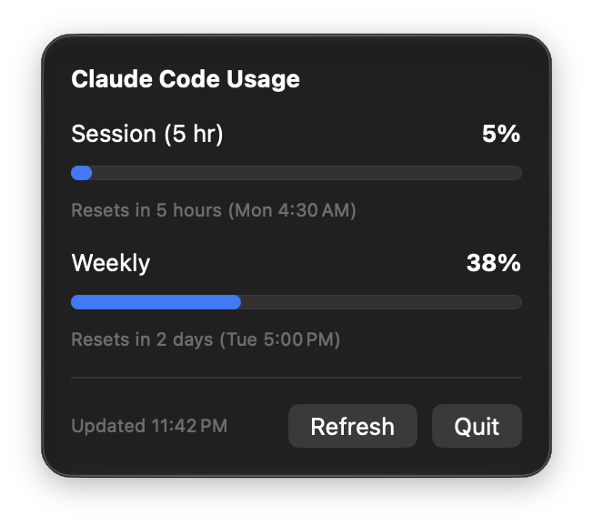

# Token Meter

A tiny macOS menu bar app that shows how much of your **Claude Code** usage limits you've used, and when they reset.

- **Menu bar percentage** for your current 5-hour session, always visible.
- **Popover** with the session and weekly limits, each with a progress bar (orange above 75%, red above 90%) and a reset countdown.
- **Auto-refreshes** every 60 seconds. No Dock icon, no window.
- **Works with both logins**: the terminal `claude` CLI and Claude in Xcode keep separate logins. Token Meter reads both and uses whichever is still valid.

The numbers are the same ones Claude Code's `/usage` command shows.

## Requirements

- macOS 27 (the project's current deployment target; lower it in the target settings if you need to)
- Xcode to build it
- A Claude Code login (a Pro or Max plan) on this Mac

## Build and run

1. Clone the repo and open `Token Meter.xcodeproj` in Xcode.
2. Press **Run**.
3. The first time it runs, macOS asks for Keychain access to Claude Code's credentials. Choose **Always Allow**.

## How it works

1. Claude Code stores its OAuth login in the macOS Keychain under `Claude Code-credentials` (the terminal CLI) and `Claude Code-credentials-<hash>` (other config directories, such as Claude in Xcode).
2. Token Meter reads every matching item and tries the token that expires last first.
3. It calls Anthropic's usage endpoint (`/api/oauth/usage`) with that token and decodes the 5-hour and 7-day windows.

The token is only ever sent to `api.anthropic.com`. It is never written to disk or logged. Token Meter never refreshes tokens itself, so it can't log Claude Code out; it relies on Claude Code keeping its own login fresh.

| File | Purpose |
|---|---|
| `UsageService.swift` | Keychain access, the usage request, response decoding |
| `UsageStore.swift` | Observable state and the 60-second refresh loop |
| `ContentView.swift` | The popover UI |
| `MyApp.swift` | `MenuBarExtra` entry point |

## Caveats

- **Unofficial.** This is an independent project and isn't affiliated with or endorsed by Anthropic.
- **Undocumented endpoint.** The usage API isn't a public, supported API and may change or break without notice. If it does, the popover shows "Unexpected response from the usage API."
- **App Sandbox is off**, because the app needs to read Claude Code's Keychain items. That also means it can't be distributed through the Mac App Store as is.
- If you see "Login expired", every Claude Code login on the Mac has expired. Use Claude Code once (in a terminal or in Xcode) to refresh it.

## License

[MIT](LICENSE)
